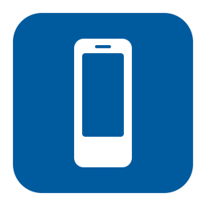
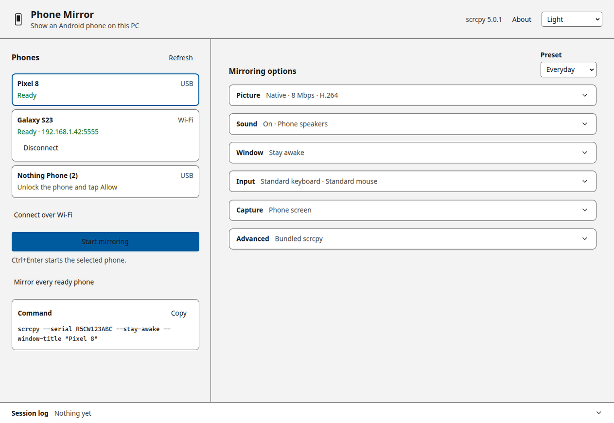
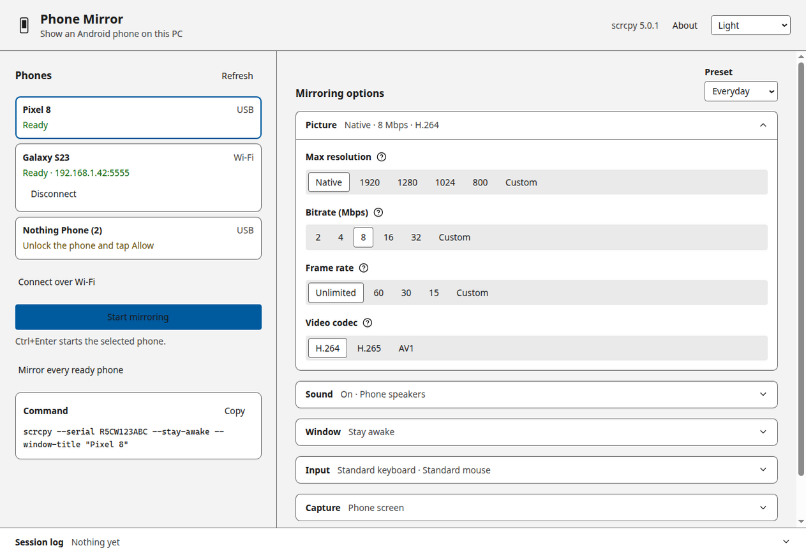
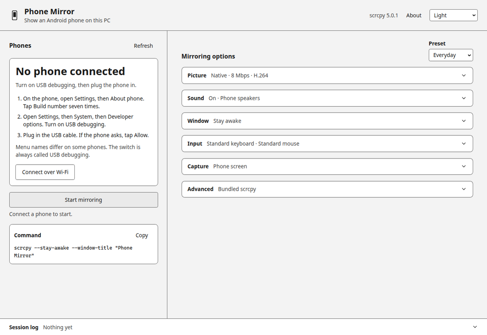
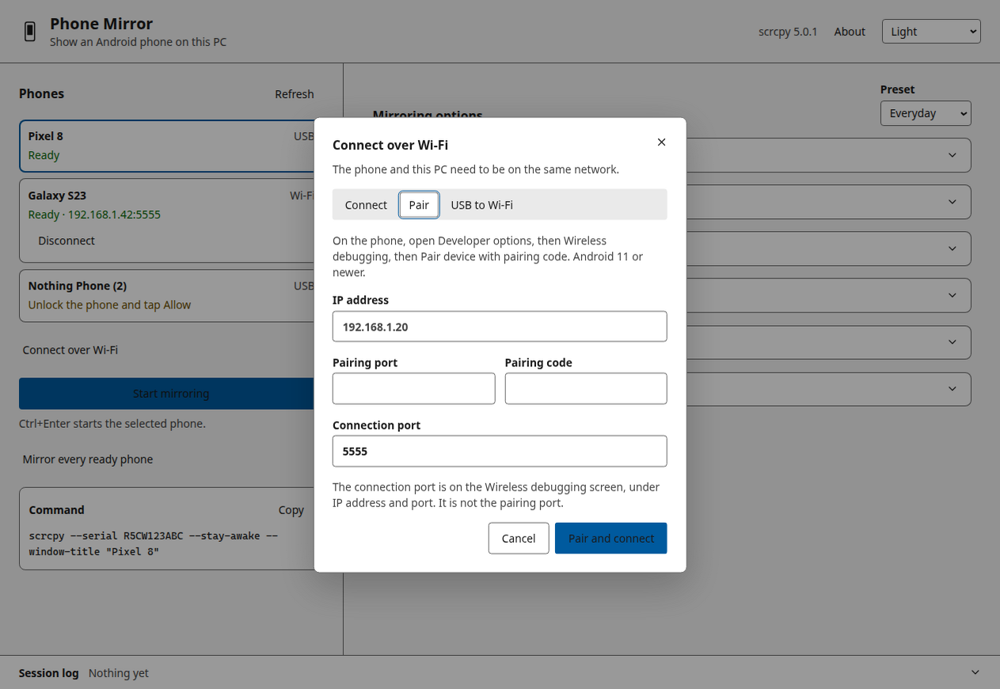

<p align="center">
  
</p>

<h1 align="center">Phone Mirror</h1>

<p align="center">
  Show an Android phone on your PC.<br />
  A desktop app for <a href="https://github.com/Genymobile/scrcpy">scrcpy</a>, on Windows and Linux. Plug in, or pair over Wi-Fi, and press Start.
</p>

<p align="center">
  <a href="LICENSE"></a>
  <a href="https://github.com/Timoteee/PhoneMirror-scrcpy-gui-/releases/latest"></a>
  <a href="https://github.com/Timoteee/PhoneMirror-scrcpy-gui-/releases/latest"></a>
  <a href="https://github.com/Timoteee/PhoneMirror-scrcpy-gui-/releases/latest"></a>
  <a href="https://github.com/Genymobile/scrcpy"></a>
</p>

<p align="center">
  <picture>
    <source media="(prefers-color-scheme: dark)" srcset="docs/screenshots/main-dark.png" />
    
  </picture>
</p>

## Why

[scrcpy](https://github.com/Genymobile/scrcpy) is the standard way to put an Android phone on a computer. It is fast, it is free, and it does not install anything on the phone. Most people bounce off the command line and the flag list.

Phone Mirror is a control panel for that tool. It shows the phones adb can see, starts a scrcpy window with one button, and groups the usual options in plain language: picture, sound, window, input, and capture. The exact argument list stays on screen, so people who already know the flags can see what will run.

The mirror window is scrcpy itself.

## Features

- Device list from `adb devices -l`, refreshed every two seconds, with USB, Wi-Fi, and emulator labels
- **Start mirroring** for the selected phone, or every ready phone at once
- Keyboard and mouse on the phone, audio from the phone, and recording to an mp4 or mkv
- Wi-Fi connect, Android 11+ pairing with a 6-digit code, and USB-to-Wi-Fi
- Presets: Everyday, Low latency, High quality, Recording, plus presets you save on this PC
- Resolution, bitrate, frame rate, and H.264 / H.265 / AV1
- Stay awake, screen off, show touches, always on top, fullscreen, borderless, view only
- Camera or a virtual display, when you want something other than the phone screen
- Plain-language errors, with the original scrcpy and adb log one click away
- Light, dark, and system themes
- Official scrcpy 5.0.1 for Windows and Linux, including `adb`, checked against the published SHA-256 sums before it is bundled
- scrcpy and adb are started with an argument array. Values you type are not passed through a shell

<p align="center">
  
</p>

## Download

Nothing is installed on the phone. Phone Mirror 1.1.0 is built for 64-bit Windows and 64-bit Linux.

<p align="center">
  <a href="https://github.com/Timoteee/PhoneMirror-scrcpy-gui-/releases/latest"><strong>Latest release</strong></a>
</p>

### Windows

Windows 10 or later.

| Build | What you get |
| --- | --- |
| [PhoneMirror-1.1.0-portable.exe](https://github.com/Timoteee/PhoneMirror-scrcpy-gui-/releases/download/v1.1.0/PhoneMirror-1.1.0-portable.exe) | One file. No installer. Put it anywhere and run it. |
| [PhoneMirror-1.1.0-setup.exe](https://github.com/Timoteee/PhoneMirror-scrcpy-gui-/releases/download/v1.1.0/PhoneMirror-1.1.0-setup.exe) | Installer for the current user, with Start menu and desktop shortcuts. You can choose the folder. |

The executables are not code-signed. The first time you open one, SmartScreen may say that Windows protected your PC. Choose **More info**, then **Run anyway**.

### Linux

Ubuntu and Debian, x86_64. Other glibc distributions can use the AppImage.

| Build | What you get |
| --- | --- |
| [PhoneMirror_1.1.0_amd64.deb](https://github.com/Timoteee/PhoneMirror-scrcpy-gui-/releases/download/v1.1.0/PhoneMirror_1.1.0_amd64.deb) | Debian package. Menu entry, `phonemirror` on the command line, and udev rules for USB. |
| [PhoneMirror-1.1.0-x86_64.AppImage](https://github.com/Timoteee/PhoneMirror-scrcpy-gui-/releases/download/v1.1.0/PhoneMirror-1.1.0-x86_64.AppImage) | One file. No installer. |

Debian package:

```bash
sudo apt install ./PhoneMirror_*.deb
```

AppImage:

```bash
chmod +x PhoneMirror-*.AppImage
./PhoneMirror-*.AppImage
```

If the AppImage says that FUSE is missing, install `libfuse2t64` on Ubuntu 24.04 or `libfuse2` on Ubuntu 22.04, or start it with `./PhoneMirror-*.AppImage --appimage-extract-and-run`.

#### USB access

Wi-Fi pairing does not need this. A USB cable does. adb has to be allowed to open the phone, which on Ubuntu and Debian means the `plugdev` group and a udev rule.

The Debian package copies `51-android.rules` to `/etc/udev/rules.d/51-android-phonemirror.rules` and reloads udev. You still add yourself to the group:

```bash
sudo usermod -aG plugdev "$USER"
```

Log out and back in, then unplug the phone and plug it back in. `groups` should list `plugdev`.

The AppImage does not install the rule. Install the same file from this repository:

```bash
curl -fsSL -o /tmp/51-android.rules https://raw.githubusercontent.com/Timoteee/PhoneMirror-scrcpy-gui-/main/build/udev/51-android.rules
sudo install -m 644 /tmp/51-android.rules /etc/udev/rules.d/51-android-phonemirror.rules
sudo udevadm control --reload-rules
sudo udevadm trigger --subsystem-match=usb
```

The rule gives the `plugdev` group access to common Android vendor ids (Google, Samsung, Xiaomi, Motorola, and others). The file in the repo lists them. A phone that still shows "USB permission denied" may need another vendor id. The longer list is at [android-udev-rules](https://github.com/M0Rf30/android-udev-rules).

If another copy of adb is already running, stop it and press F5 in Phone Mirror:

```bash
adb kill-server
```

### Checksums

Each release attaches `SHA256SUMS.txt` for the Windows and Linux files.

```powershell
Get-FileHash .\PhoneMirror-1.1.0-portable.exe -Algorithm SHA256
```

```bash
sha256sum -c SHA256SUMS.txt
```

## Quick start

1. On the phone, open **Settings → About phone** and tap **Build number** seven times.
2. Open **Settings → System → Developer options** and turn on **USB debugging**. Menu names differ by brand. The switch is always called USB debugging.
3. Plug the phone into the PC with a data cable. If the phone asks, tap **Allow**.
4. In Phone Mirror, select the phone and click **Start mirroring**. Ctrl+Enter does the same thing. F5 refreshes the list.

scrcpy opens its own window. That window is the phone. Close it, or click **Stop mirroring**, when you are done.

<p align="center">
  
</p>

## Wireless

The phone and the PC need to be on the same network. Open **Connect over Wi-Fi**.

### Pair (Android 11 or newer)

1. On the phone, open **Developer options → Wireless debugging → Pair device with pairing code**.
2. In Phone Mirror, choose **Pair**.
3. Enter the IP address, the **pairing port**, and the **6-digit code** from that dialog. The code expires quickly. If it fails, go back and generate a new one.
4. The **connection port** is the port on the Wireless debugging screen, under IP address and port. It is a different number from the pairing port.

### Already listening

Choose **Connect** and enter the IP address and port. This is the right tab when the phone is already listening, often on port 5555.

### USB to Wi-Fi

Plug in a phone that is already allowed, and join it to Wi-Fi. Choose **USB to Wi-Fi**. Phone Mirror asks the phone to listen, then connects. After the phone shows up as Wi-Fi in the list, you can unplug the cable.

<p align="center">
  
</p>

## Keyboard

| Key | Action |
| --- | --- |
| Ctrl+Enter | Start or stop mirroring for the selected phone |
| F5 | Refresh the phone list |
| Arrow keys | Move through the phone list |
| Space | Select the highlighted phone |

Inside the scrcpy window, the keyboard and mouse go to the phone unless you set **View only**.

## FAQ

**The phone does not appear.** Use a cable that carries data, not a charge-only cable. Unlock the phone, accept the USB debugging prompt, and press F5. On some phones you also have to set the USB mode to file transfer. On Linux, a missing udev rule looks like "USB permission denied". Follow the USB access steps above. On Windows, try another USB port, then install the manufacturer's USB driver.

**It says to unlock the phone and tap Allow.** The phone is connected and waiting for the debugging prompt. Unlock it and tap Allow. Checking "Always allow from this computer" saves you from doing it every time.

**It says the phone is offline.** Unplug the cable, plug it back in, and unlock the phone.

**Pairing fails.** Check the IP address, and make sure the pairing port and the connection port were not swapped. Pairing codes are single use. Open the pairing dialog on the phone again and use the new code. A VPN on either side can block the connection.

**There is no sound.** Open **Sound** and turn audio on. The source defaults to the phone speakers. Android 11 or newer is required for audio. If Windows is playing the sound through a device you do not expect, pick that device in the Windows volume mixer.

**Where do recordings go?** Open **Capture**, turn recording on, and choose an mp4 or mkv path. The Recording preset does this for you. If no file is chosen, Start mirroring tells you, and does not start.

**Which Android versions work?** scrcpy 5.0.1 needs Android 5 or newer. Wireless pairing with a code needs Android 11 or newer. Audio needs Android 11 or newer.

**Does this install an app on the phone?** No. scrcpy starts a temporary server over adb and removes it when the session ends.

**Can I use my own scrcpy?** Open **Advanced** and choose the scrcpy program from an official build (`scrcpy.exe` on Windows, `scrcpy` on Linux). adb has to sit in the same folder.

**SmartScreen or an antivirus complains.** The download is unsigned, so SmartScreen warns on first launch. Use **More info → Run anyway** if you trust the file, and compare the SHA-256 with `SHA256SUMS.txt` first. The bundled `scrcpy.exe` and `adb.exe` are the official Genymobile binaries.

## Build from source

Requirements: Node.js 22 or newer. Packaging the Windows app on Linux also needs Wine. The Linux packages are built on Linux.

```bash
npm install
npm test
npm run dev
```

`npm run dev` and `npm run build` run `scripts/fetch-scrcpy.mjs`. That script downloads scrcpy 5.0.1 from the [official release](https://github.com/Genymobile/scrcpy/releases/tag/v5.0.1), verifies `SHA256SUMS.txt`, and unpacks the Windows x64 zip into `resources/scrcpy-win64`. On Linux and macOS it also unpacks the Linux build into `resources/scrcpy-host`. Packaged apps place that platform's build at `resources/scrcpy`, and the app starts scrcpy with `ADB` and `SCRCPY_SERVER_PATH` pointed at those files.

```bash
npm run dist
npm run dist:linux
```

`npm run dist` is `electron-vite build` followed by `electron-builder --win --x64 --publish never`. The output is:

- `release/PhoneMirror-1.1.0-portable.exe`
- `release/PhoneMirror-1.1.0-setup.exe`

`npm run dist:linux` is the same build followed by `electron-builder --linux deb AppImage --x64 --publish never`. The output is:

- `release/PhoneMirror_1.1.0_amd64.deb`
- `release/PhoneMirror-1.1.0-x86_64.AppImage`

## Contributing

See [CONTRIBUTING.md](CONTRIBUTING.md). Interface decisions live in [DESIGN.md](DESIGN.md).

## Credits

Phone Mirror is a front end. The mirroring is [scrcpy](https://github.com/Genymobile/scrcpy) by Genymobile and Romain Vimont, licensed under the Apache License 2.0. Version 5.0.1 is bundled. Please thank the scrcpy project if Phone Mirror is useful to you. The license text ships in the app and is shown under **About**. Details are in [THIRD-PARTY-NOTICES.md](THIRD-PARTY-NOTICES.md).

## License

Phone Mirror is [MIT](LICENSE), copyright 2026 Timoteee.

The bundled scrcpy binaries remain under the Apache License 2.0, copyright Genymobile and Romain Vimont. See [`third_party/scrcpy/LICENSE`](third_party/scrcpy/LICENSE).
